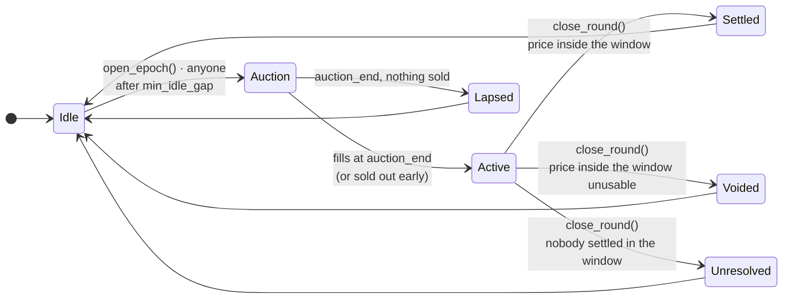
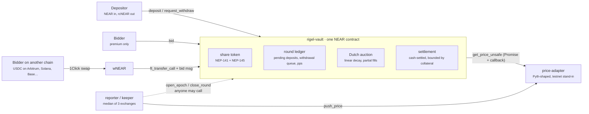

<div align="center">


# Rigel

**Covered call vaults on NEAR.**
Deposit NEAR, an on-chain auction discovers what a call over it is worth, and the premium goes to the depositors.

`pre-alpha` · `NEAR testnet` · `unaudited` · `Apache-2.0`

</div>

---

Rigel writes a cash-settled call against a pool of NEAR once per round and sells it in a **descending-price
auction that anyone can bid into**. The premium the auction discovers is credited to depositors whatever the
option does next. There is no quote engine and no operator in the exit path: opening and closing a round take no
authorization, and the caller of `close_round` cannot choose how the round ends.

Built for NEAR HACKATHON (Unstoppable DeFi track). **Everything in this repository was written during the
hackathon**, with the oracle rules designed around a pull oracle (see [Oracle rules](#oracle-rules)).

## What it does

1. You deposit NEAR and receive **rcNEAR**, a NEP-141 share of the pool.
2. Each round the vault sells a **call option** over the pool: the right to the part of NEAR's rise past a fixed
   **strike** at a set **expiry**, paid in NEAR.
3. The buyer pays a **premium** up front. It goes to the pool and stays there whatever happens next.
4. At expiry:
   - **below the strike**, the option is worthless; the pool keeps collateral and premium;
   - **above the strike**, the pool pays `notional × (spot − strike) / spot` NEAR out of its collateral, and
     depositors still keep the premium.

The trade is stated as it is: **you earn a premium every round, and in exchange give up the part of a rally past
the strike.** There is no APY anywhere in this repository or the interface.

## How a round works



- **Open.** `open_epoch` reads a fresh price (at most `max_staleness` old, confidence interval at most
  `max_conf_bps` wide) and sets `strike = spot × (1 + strike_bps_otm)`. The whole pool is offered.
- **Auction.** The premium falls linearly from `premium_start_bps` to `premium_floor_bps` of notional. `bid` takes
  a `max_premium_bps` ceiling, fills at the current point of the curve, and refunds the difference. Partial fills
  are allowed. A bid is refused while the price is already at or above the strike.
- **Close.** One entry point, `close_round`, dispatches on what the price data says. All four outcomes are normal.

| Outcome | When | Option holders | Depositors |
|---|---|---|---|
| **Settled** | a usable price published in `[expiry, expiry + settle_window]` | paid if above the strike | keep the premium |
| **Lapsed** | the auction ended with nothing sold | nothing | untouched |
| **Voided** | the price in the window is unusable (bad confidence, changed exponent) | premium refunded in full | untouched |
| **Unresolved** | nobody settled inside the window | nothing | keep the premium |

From `expiry + unresolved_after` on, `close_round` resolves the round as `Unresolved` **without calling the oracle
at all**, so no oracle state can keep a round, or anyone's funds, open forever.

Deposits made while a round is live wait as pending deposits (cancellable at any time) and join when the round
ends. Withdrawals requested while a round is live burn their shares at once and are paid at that round's recorded
price-per-share. Every claim is recomputed from a round record that is written once and never rewritten.

## Bidding from another chain (NEAR Intents)

A bidder does not need NEAR. The vault accepts bids paid in **wNEAR through `ft_transfer_call`**, which is exactly
how the [1Click API](https://docs.near-intents.org/) delivers a swap's output to a NEAR contract when the quote
carries a `customRecipientMsg`:

```json
{"bid":{"notional":"1000000000000000000000000","max_premium_bps":150,"beneficiary":"alice.near"}}
```

So someone holding USDC on Arbitrum, Solana, Base or Ethereum asks 1Click for **exactly** the wNEAR the bid needs
(`EXACT_OUTPUT`), sends USDC to the quote's deposit address, and 1Click delivers the wNEAR to the vault with that
message. In [`intents.rs`](contracts/rigel-vault/src/intents.rs) the vault:

1. checks the bid **before** taking anything; a wrong token, a message that is not a bid, or a bid that would fail
   is returned in full, as NEP-141 requires;
2. keeps the wNEAR and unwraps it with `near_withdraw`;
3. runs the same price read and fill as a native bid. Refunds and any payout go to the **beneficiary**'s NEAR account.

**What runs where.** 1Click runs on mainnet only and Rigel is deployed on testnet, so the app does two honest
things: it asks 1Click for a live **dry** quote of the swap leg (real mainnet price and time, nothing moves, no
deposit address), and it performs the delivery leg on testnet itself through `wrap.testnet` with the same call and
the same message. The vault code path is identical; only who makes the final `ft_transfer_call` differs.

## Oracle rules

NEAR's Pyth receiver stores a price only when someone pushes a signed update, and keeps only the newest one. So
"the price at expiry" is defined as **the first price published inside `[expiry, expiry + settle_window]`**:

- A reading published **before** expiry does not close the round (`close_round` resolves to `null`; push a newer
  price and call again).
- A reading published **after** the window means nobody settled in time: `Unresolved`.
- Option holders profit from settling inside the window when the option is in the money, so the party with
  something to lose is the one with every reason to act. A keeper closes rounds anyway; it is a convenience, not an
  authority, and anyone can do its job.

Every oracle read is a cross-contract call with a callback. **Callbacks never panic while they hold someone's
NEAR**: a bid whose checks fail in the callback is refunded in full.

### The price source on testnet, stated plainly

Pyth on NEAR has **not updated since 26 Aug 2026**, the day Pyth's Hermes service began requiring an API key
(`pyth-oracle.near` last `publish_time` is 1787699235; `pyth-oracle.testnet` holds no feeds; `priceoracle.near`
returns `null`). There is no live price to read on NEAR today.

So this deployment reads [`price-adapter`](contracts/price-adapter/src/lib.rs), a small contract that exposes
**Pyth's exact `get_price_unsafe` view and JSON shape**. A reporter script pushes the median NEAR/USD of Binance,
Coinbase and Kraken, with half their spread as the confidence interval. **It is trusted**: the reporter can push
any price. The adapter only narrows what it can do (no rewriting history, nothing from the future). The vault
needs no change to read real Pyth again: its oracle account and feed id are constructor arguments.

## Architecture



| Path | What |
|---|---|
| [`contracts/rigel-vault`](contracts/rigel-vault/src) | The vault: `epoch.rs` (open, bid, close, oracle callbacks), `intents.rs` (wNEAR bids via `ft_transfer_call`), `vault.rs` (deposits, withdrawals), `claims.rs`, `views.rs`, `token.rs` (NEP-141/145/148), `math.rs` (pure arithmetic, 256-bit `mul_div`) |
| [`contracts/price-adapter`](contracts/price-adapter/src/lib.rs) | Pyth-compatible price store for testnet |
| [`reporter`](reporter/src/report.ts) | Pushes NEAR/USD; with `--keeper`, opens and closes rounds |
| [`web`](web) | Next.js app: Vault, Rounds, Claims, My positions |

## What's deployed (NEAR testnet)

| Account | What |
|---|---|
| [`vault.rigel-demo.testnet`](https://testnet.nearblocks.io/address/vault.rigel-demo.testnet) | The vault; accepts wNEAR bids from `wrap.testnet` |
| [`oracle.rigel-demo.testnet`](https://testnet.nearblocks.io/address/oracle.rigel-demo.testnet) | The price adapter; reporter `rigel-demo.testnet` |

**On-chain evidence (testnet).** A full round on the first deployment, settled in the money:

| Step | Transaction |
|---|---|
| Bid, 1 NEAR notional at 1.17 % | [`5BcL3Jk3…`](https://testnet.nearblocks.io/txns/5BcL3Jk3SzTVcpEjtMsEjvJUXsoQi6ytRxfvMZiQRZ93) |
| Keeper closes: **Settled**, spot 3.7888 above strike 3.7845, payout 0.001127 NEAR | round 1 record on the first deployment |
| Option holder claims the payout | [`5QHWg63m…`](https://testnet.nearblocks.io/txns/5QHWg63mTkkaSxpb5BjJuz4F2kGyBB3yrH76ZPD5aD7e) |
| Depositor withdraws 2.0104 NEAR for 2 deposited | [`9wYdStxF…`](https://testnet.nearblocks.io/txns/9wYdStxF7P6JiNMtPukHTaY9DUqmwUY7yaYPWGWcfAs2) |
| On the current deployment: a bid delivered as wNEAR via `ft_transfer_call` (`ft_on_transfer` → `near_withdraw` → price read → `bid_filled`), in one transaction | [`511Qj75D…`](https://testnet.nearblocks.io/txns/511Qj75D8X96rHzr6NbaeRdH59bYuB2uRJyLa6qPSmbi) |

The vault was redeployed between the two to add the wNEAR path, which changed its state layout.

Demo parameters, short so a whole round fits in a demo: 20-minute rounds, 5-minute auction falling from 1.50 % to
0.20 % of notional, strike 0.50 % above spot, 2-minute settlement window, `Unresolved` after 10 minutes, 0.5 % of
premium to whoever closes the round.

## Building

Requirements: Rust (stable) with `wasm32-unknown-unknown`, [`cargo-near`](https://github.com/near/cargo-near),
Node 22.18+ and pnpm.

```bash
# contracts
cargo test --workspace                      # unit tests: vault lifecycle + adapter
cd contracts/rigel-vault   && cargo near build non-reproducible-wasm && cd ../..
cd contracts/price-adapter && cargo near build non-reproducible-wasm && cd ../..

# web
pnpm install
cd web && pnpm build                        # static export in web/out
pnpm dev                                    # http://localhost:3000, reads the testnet deployment
```

The web app reads `vault.rigel-demo.testnet` by default; set `NEXT_PUBLIC_VAULT`, `NEXT_PUBLIC_ORACLE` and
`NEXT_PUBLIC_NEAR_RPC` to point it elsewhere.

### Running your own deployment

```bash
near account create-account sponsor-by-faucet-service <you>.testnet autogenerate-new-keypair save-to-legacy-keychain network-config testnet create
near account create-account fund-myself oracle.<you>.testnet '2 NEAR' autogenerate-new-keypair save-to-legacy-keychain sign-as <you>.testnet network-config testnet sign-with-legacy-keychain send
near account create-account fund-myself vault.<you>.testnet '4 NEAR' autogenerate-new-keypair save-to-legacy-keychain sign-as <you>.testnet network-config testnet sign-with-legacy-keychain send
near contract deploy oracle.<you>.testnet use-file target/near/price_adapter/price_adapter.wasm with-init-call new json-args '{"reporter":"<you>.testnet"}' prepaid-gas '30 Tgas' attached-deposit '0 NEAR' network-config testnet sign-with-legacy-keychain send
near contract deploy vault.<you>.testnet use-file target/near/rigel_vault/rigel_vault.wasm with-init-call new file-args deploy/vault-init.testnet.json prepaid-gas '100 Tgas' attached-deposit '0 NEAR' network-config testnet sign-with-legacy-keychain send
near contract call-function as-transaction wrap.testnet storage_deposit json-args '{"account_id":"vault.<you>.testnet","registration_only":true}' prepaid-gas '30 Tgas' attached-deposit '0.00125 NEAR' sign-as <you>.testnet network-config testnet sign-with-legacy-keychain send
NEAR_ACCOUNT=<you>.testnet node reporter/src/report.ts --keeper
```

(Edit `oracle` in `deploy/vault-init.testnet.json` to your adapter account first. `wnear` names the token the
vault accepts bids in; set it to `null` to turn the wNEAR path off. The last command registers the vault with
`wrap.testnet` so it can receive wNEAR.)

## Testing

`cargo test --workspace` runs the unit suites. The vault suite drives every oracle callback directly with the
reading it would receive and keeps a **shadow ledger**: every yoctoNEAR attached and every transfer receipt is
tracked, and after every step the contract's own liabilities must equal the NEAR it holds for users, exactly. It
covers all four outcomes, in-the-money bid refusal, stale and wide-confidence prices, the idle gap, duplicate
callbacks, pending deposits and queued withdrawals across rounds, double claims, and a five-round run with mixed
outcomes. Pure arithmetic (`math.rs`) is tested separately, including solvency for any spot.

## Honest limitations

- **Unaudited, testnet only.**
- **The price source is trusted** on this deployment (see above). The vault is not; it reads whatever account it was
  deployed against, which is public in `get_config`.
- **A closer chooses the moment inside the settlement window**, and so which price inside it settles the round.
  The window is short (2 minutes here) to bound this; a time-weighted average would remove it, but a latest-price
  pull oracle cannot provide one.
- **Storage** for each depositor and bidder record is charged to the caller (attach 0.01 NEAR, unused part
  refunded); round records are paid by the contract's own balance.
- **Cross-chain bids are proven on testnet up to the delivery leg.** The swap leg is a live mainnet dry quote;
  a real 1Click swap needs a mainnet deployment. 1Click marks `customRecipientMsg` experimental, and how much gas its
  `ft_transfer_call` forwards is not documented; the vault's wNEAR path needs about 100 Tgas.
- If `near_withdraw` ever failed, the wNEAR would stay in the vault, recorded by an `unwrap_failed` event, with no
  automatic return.
- **Not built yet:** payouts back to the origin chain, multiple vaults, an upgrade path, fuzzing.

## License

Apache-2.0. Fonts in `web/public/fonts` are under the SIL Open Font License (see the license files there).
